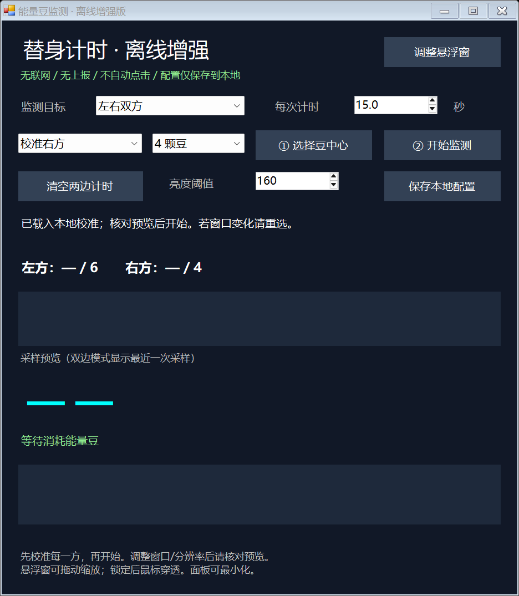

# 火影忍者替身计时啥子方法

Windows 本地屏幕像素识别替身计时器，默认 **15 秒**。纯离线运行，不上报、不读取游戏内存、不发送游戏按键、不自动点击。



## 下载和使用

1. 下载 [EnergyBeanMonitor-Offline.exe](bin/EnergyBeanMonitor-Offline.exe?raw=1)，在 Windows 中运行。
2. 选择校准右方/左方，以及该方总共 **4 颗或 6 颗豆**。点击“选择豆中心”，暗豆也要选。
3. 监测双方时，先分别校准两边，再选择“左右双方”；支持左 6、右 4 等不同配置。
4. 点击“开始监测”。每少一颗独立计时，多颗同时减少会分别创建计时。
5. 点击“调整悬浮窗”拖动位置、拖边缩放；完成后锁定，浮字透明、鼠标穿透。

单边显示绿色 **替身：xx.x s**；双边分别显示左替身、右替身，各显示最近到期的一项。完整计时列表在控制面板中。倒计时使用单调时钟，暂停识别不会暂停已开始的计时。

## 功能

- 左/右/双边监测，分别手动选择 4/6 豆；并非自动识别角色。
- 红、蓝、赤金亮豆与暗豆分类，连续帧确认，减少短暂闪光误触发。
- 小区域屏幕采样；窗口移动/缩放按相对位置跟随。
- 默认 15.0 秒，可调阈值、计时秒数，支持多条独立计时。
- 绿色黑描边浮字，可拖动缩放，锁定后鼠标穿透。
- 本地类型化 XML 保存校准/参数，禁止 DTD/外部实体，不执行配置代码。

## 构建与测试

需要 Windows 和系统 .NET Framework 4.x，无 Python/NuGet/网络服务依赖。

```powershell
powershell -NoProfile -ExecutionPolicy Bypass -File .\build.ps1
powershell -NoProfile -ExecutionPolicy Bypass -File .\tests\run.ps1
```

构建结果在 `bin/EnergyBeanMonitor-Offline.exe`。`SHA256SUMS.txt` 记录发布文件完整性哈希。

## 本地配置与隐私

运行后会在程序旁生成 `monitor-settings.xml` 和 `overlay-layout.txt`，只保存本地校准和界面参数。本仓库不包含作者的个人校准文件、工作目录、私人路径、第三方程序/素材或内部回滚备份。

## 限制

- 游戏窗口和豆的位置必须可见；豆被遮挡或游戏最小化时不识别。切到其他应用时浮字隐藏。
- 不可见期间的消耗不补计时。切换对局前暂停并清空旧计时。
- 约 0.2 秒稳定确认后才开始计时，不等于游戏内部精确消耗时刻。
- 改变布局、分辨率或 DPI 后需要重新核对和校准；同名窗口不唯一时请重新选择。
- 不保证所有角色皮肤、闪光、独占全屏或受保护画面都准确。
- 本地屏幕夹具和单元测试已通过，不等于长期实战稳定性保证。
- 这是非官方工具，不与游戏发行方关联；没有反作弊绕过或内存修改功能。

详见 [测试说明](docs/TESTING.md)。
